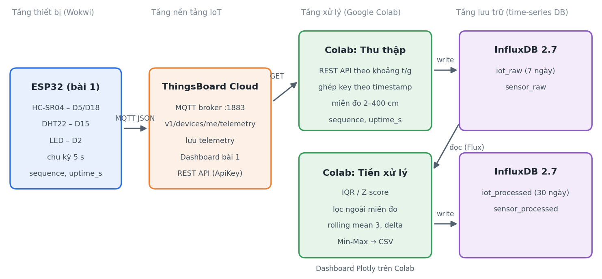
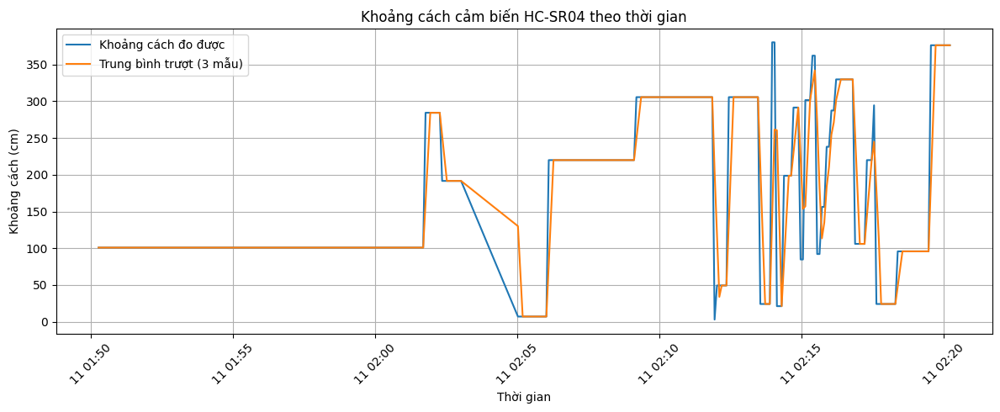
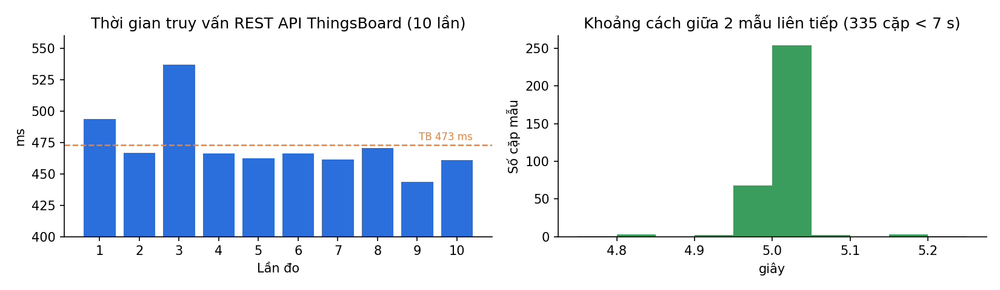

# Bài thực hành số 2 — Thu thập, lưu trữ và tiền xử lý dữ liệu IoT

**IoT và Ứng dụng (INT14149)** · Trần Mạnh Khiêm · B23DCCN437 · Nhóm 04 tổ 2

Nối tiếp Bài thí nghiệm số 1: nút cảm biến ESP32 mô phỏng trên Wokwi gửi telemetry lên ThingsBoard Cloud. Bài 2 lấy dữ liệu đó về Google Colab để kiểm tra, tiền xử lý, lưu vào cơ sở dữ liệu time-series InfluxDB và đo độ trễ. Mọi bước chạy trên trình duyệt, không cần cài đặt.



```
ESP32 (Wokwi) ──MQTT──► ThingsBoard Cloud ──REST API──► Google Colab ──► InfluxDB Cloud
 HC-SR04, DHT22, LED     lưu telemetry, dashboard        thu thập, kiểm tra,     iot_raw (7 ngày)
 gửi mỗi 5 s                                              tiền xử lý, độ trễ      iot_processed (30 ngày)
```

## Cấu trúc thư mục

| Đường dẫn | Nội dung |
|---|---|
| `firmware/esp32_wokwi/` | `sketch.ino`, `diagram.json`, `libraries.txt` — mạch và chương trình ESP32 của bài 1 |
| `notebooks/IoT_Bai2_ThuThap_TienXuLy.ipynb` | Notebook Colab: thu thập, kiểm tra, tiền xử lý, lưu InfluxDB, dashboard, đo độ trễ |
| `config.json` | Các tham số dùng trong notebook (không chứa khóa bí mật) |
| `data/iot_telemetry_processed.csv` | 337 mẫu sau tiền xử lý (11 cột) |
| `data/latency_results.csv` | 10 lần đo thời gian truy vấn REST API |
| `results/` | Biểu đồ kết quả |

## Cách chạy

### 1. Thiết bị trên Wokwi
1. Vào https://wokwi.com → New Project → ESP32.
2. Dán `firmware/esp32_wokwi/sketch.ino` vào `sketch.ino` và `diagram.json` vào `diagram.json`; thêm 2 thư viện trong `libraries.txt`.
3. Trên ThingsBoard Cloud (https://thingsboard.cloud): *Entities → Devices* → tạo thiết bị → *Copy access token*, dán vào biến `TOKEN` trong sketch (**không commit token thật**).
4. Bấm **Start**. Serial Monitor phải hiện `[MQTT] CONNECTED` và `PUBLISH OK` mỗi 5 giây.

| Linh kiện | Chân ESP32 |
|---|---|
| DHT22 (SDA) | D15 |
| HC-SR04 (TRIG / ECHO) | D5 / D18 |
| LED (qua điện trở 220 Ω) | D2 |

### 2. Notebook trên Google Colab
1. https://colab.research.google.com → *File → Open notebook → GitHub* → dán link repo này → chọn `notebooks/IoT_Bai2_ThuThap_TienXuLy.ipynb`.
2. Sửa `DEVICE_ID` (mục 1) thành ID thiết bị ThingsBoard của bạn.
3. Tạo API key: ThingsBoard → *Account → Security → API keys → Generate*.
4. *Runtime → Run all*, nhập API key khi được hỏi (dùng `getpass`, không hiện ra màn hình).
5. Mục 7 (InfluxDB): đăng ký miễn phí tại https://cloud2.influxdata.com, bucket đầu tiên đặt tên `iot_raw`, tạo thêm `iot_processed`; sửa `INFLUX_URL`, `INFLUX_ORG`, nhập token khi được hỏi.

## Dữ liệu

Bản tin ESP32 gửi lên ThingsBoard (định dạng giữ nguyên từ bài 1):

```json
{"distance_cm":100.86,"rssi":-64,"sequence":212,"uptime_s":1061}
```

Schema InfluxDB:

| Bucket (retention) | Measurement | Tag | Field |
|---|---|---|---|
| `iot_raw` (7 ngày) | `sensor_raw` | device_id | distance_cm, rssi (float); sequence, uptime_s (integer) |
| `iot_processed` (30 ngày) | `sensor_processed` | device_id | distance_rolling_mean, distance_delta, các cột `*_scaled` |

## Kết quả chính (11/10/2026, 08:50–09:20)

| Chỉ số | Giá trị |
|---|---|
| Mẫu thu được / hợp lệ / loại do ngoài miền 2–400 cm | 360 / 337 / 23 |
| Chu kỳ gửi | trung vị 5,000 s |
| Mất bản tin theo `sequence` / khởi động lại theo `uptime_s` | 0 / 1 |
| Ngoại lệ IQR / Z-score trên `distance_cm` | 0 / 0 |
| Thời gian truy vấn REST ThingsBoard (10 lần) | trung bình 472,9 ms (443,9 – 536,9 ms) |




## Bảo mật
- API key ThingsBoard và token InfluxDB chỉ nhập bằng `getpass` khi chạy, không lưu trong notebook hay repo.
- Notebook trong repo đã xóa output để không lộ thông tin tài khoản.
- Access token thiết bị trong `sketch.ino` để trống.
